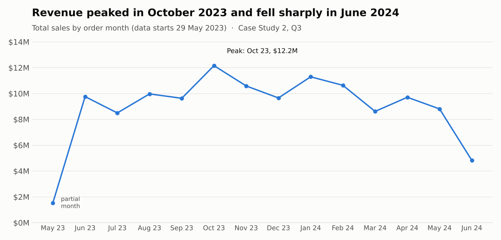
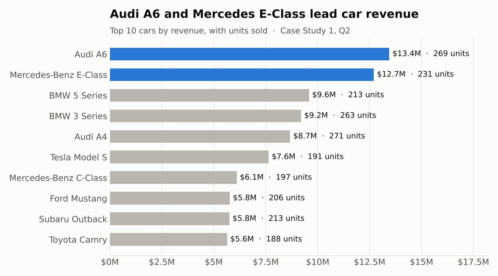
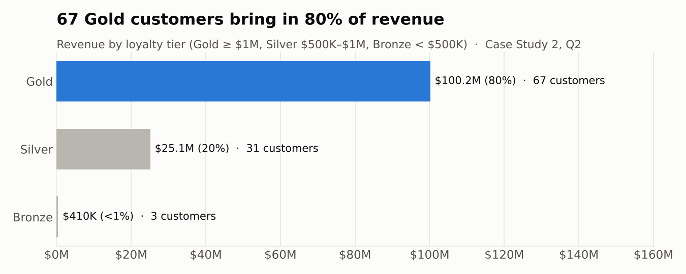
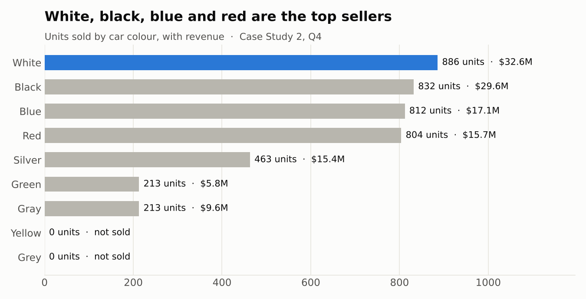

# MotivaAutos: Sales and Customer Analysis (PostgreSQL)

A PostgreSQL analysis of a car dealership's sales database: 1,050 orders from 110 customers across 30 car models, between May 2023 and June 2024. Built as two case studies in a SQL for Data Analytics course, answering business questions on customers, car performance, loyalty and sales trends.

## Business problem

MotivaAutos is a fast-growing US car dealership that sells a wide range of vehicles to customers in cities across the country. Management has moved its sales, customer and inventory data into a relational database, but the team lacks the SQL skills to turn it into decisions. This project answers management's questions directly from the database and draws out insights for sales and marketing strategy.

## Key findings

All money values are in US dollars.

| # | Finding | Evidence | Source |
|---|---------|----------|--------|
| 1 | The dealership sold $125.7M of cars | 4,223 units across 1,050 orders; average order value $119,727.62 | CS2 Q1 |
| 2 | Revenue is concentrated in a loyal core | 67 Gold customers (≥ $1M each) generate $100.2M, 80% of revenue; 31 Silver bring $25.1M and only 3 are Bronze | CS2 Q2 |
| 3 | Premium sedans lead car revenue | Audi A6 ($13.4M, 269 units) and Mercedes-Benz E-Class ($12.7M, 231 units) top the list, followed by the BMW 5 and 3 Series | CS1 Q2 |
| 4 | Sales were steady for a year, then dropped | Monthly revenue ran at $8.5M–$12.2M from June 2023 to May 2024, peaking in October 2023, then fell to $4.8M (50 orders) in June 2024 | CS2 Q3 |
| 5 | Neutral colours sell best | White (886 units, $32.6M) and black (832 units) lead; yellow and grey cars in stock have not sold | CS2 Q4 |
| 6 | The most expensive car sold is the Mercedes-Benz E-Class | $55,000 per unit; the dearest car in the showroom, a $60,000 Cadillac Escalade, has never been sold | CS1 Q4 |
| 7 | Customers buy repeatedly | The most active customer placed 19 orders; 101 of 110 customers have bought at least once | CS1 Q1 |

## Visuals



| | |
|---|---|
|  |  |



All charts are drawn directly from the CSV files in `results/`.

## Repository structure

```
motivaautos-sql-analysis/
├── README.md
├── .gitignore
├── sql/
│   ├── case_study_1.sql          # customers, car performance, high-value customers, most expensive car
│   ├── case_study_2.sql          # total sales, loyalty tiers, monthly trend, colour preferences
│   └── sql_fundamentals.sql      # SELECT, filtering, sorting and aggregate practice queries
├── results/
│   ├── case_study_1/             # one CSV per Case Study 1 query
│   └── case_study_2/             # one CSV per Case Study 2 query
├── images/                       # charts built from the results
└── data/
    └── MotivaAutos_Database      # PostgreSQL dump (custom format)
```

## Data model

Three tables: every order links one customer to one car.

| Table | Rows | Contents | Key |
|-------|------|----------|-----|
| `orders` | 1,050 | Order date, quantity sold, sales amount | `order_id`; FKs `car_id`, `customer_id` |
| `customers` | 110 | Name, age, email, city | `customer_id` |
| `cars` | 30 | Brand, model, colour, unit price | `car_id` |

## Questions and results

### Case Study 1 (`sql/case_study_1.sql`)

| Query | Question | Result |
|-------|----------|--------|
| Q1 | Provide the full name, email and total orders for customers who have placed an order | [`q01_customer_orders.csv`](results/case_study_1/q01_customer_orders.csv) |
| Q2 | Retrieve the cars that have been ordered, with their revenue and units sold | [`q02_car_revenue_and_units.csv`](results/case_study_1/q02_car_revenue_and_units.csv) |
| Q3 | Find the customers who have spent more than the average sales revenue across all orders | [`q03_customers_above_average_order_value.csv`](results/case_study_1/q03_customers_above_average_order_value.csv) |
| Q4 | Retrieve the most expensive car sold, by unit price | [`q04_most_expensive_car_sold.csv`](results/case_study_1/q04_most_expensive_car_sold.csv) |

### Case Study 2 (`sql/case_study_2.sql`)

| Query | Question | Result |
|-------|----------|--------|
| Q1 | What are the total sales and total quantity sold across all orders? | [`q01_total_sales_and_quantity.csv`](results/case_study_2/q01_total_sales_and_quantity.csv) |
| Q2 | Segment customers into Gold, Silver and Bronze loyalty tiers by revenue | [`q02_customer_loyalty_tiers.csv`](results/case_study_2/q02_customer_loyalty_tiers.csv) |
| Q3 | What is the monthly sales trend? | [`q03_monthly_sales_trend.csv`](results/case_study_2/q03_monthly_sales_trend.csv) |
| Q4 | Which car colours are purchased most frequently? | [`q04_car_colour_preferences.csv`](results/case_study_2/q04_car_colour_preferences.csv) |

`sql/sql_fundamentals.sql` holds the practice queries written while learning the basics on the same database (`SELECT`, `DISTINCT`, `WHERE`, `ORDER BY`, `LIMIT`, `BETWEEN`, `IN`, `LIKE`/`ILIKE`, aliases, arithmetic and aggregates). They explore the raw tables, so their output is not saved in `results/`.

## SQL techniques used

- `INNER JOIN` and `LEFT JOIN` across customers, orders and cars
- Aggregation with `SUM`, `COUNT`, `AVG`, `MIN`, `MAX` and `ROUND`
- `GROUP BY` with `HAVING`, including a scalar subquery as the threshold (CS1 Q3)
- Subqueries in `WHERE` with `IN` and `MAX` (CS1 Q4)
- `CASE` expressions to segment customers into tiers (CS2 Q2)
- `COALESCE` to show unsold colours as zero (CS2 Q4)
- Date handling with `DATE_TRUNC` and `TO_CHAR` for a monthly trend (CS2 Q3)
- String concatenation with `||` to build full names

## Data notes

- **Duplicate customer records.** Customers 1 and 80 share the name John Doe and the same email but have different ages, so queries group by `customer_id` rather than by name to keep them separate.
- **Unsold stock.** 5 of the 30 cars have never been ordered, including the most expensive car in the showroom. CS1 Q4 therefore looks only at cars that appear in orders.
- **Colour spelling.** The `cars` table holds both "Gray" and "Grey". They are shown as recorded; the "Grey" car has not sold.
- **Average benchmark in CS1 Q3.** The question compares each customer's total spend with the average value of a single order ($119,727.62), so 100 of the 101 buying customers clear it.
- **Partial first month.** Orders start on 29 May 2023, so May 2023 is a partial month in the trend.
- **Consistent sales amounts.** In every order, `sales_amount` equals `quantity_sold × unit_price`.

## How to run

Requires PostgreSQL 16 or later (the dump was created with PostgreSQL 16).

```bash
createdb motiva_autos
pg_restore -d motiva_autos --no-owner data/MotivaAutos_Database
psql -d motiva_autos -f sql/case_study_1.sql
psql -d motiva_autos -f sql/case_study_2.sql
```

The queries were developed in pgAdmin 4; any PostgreSQL client works.

## Author

Joshua Oleru
